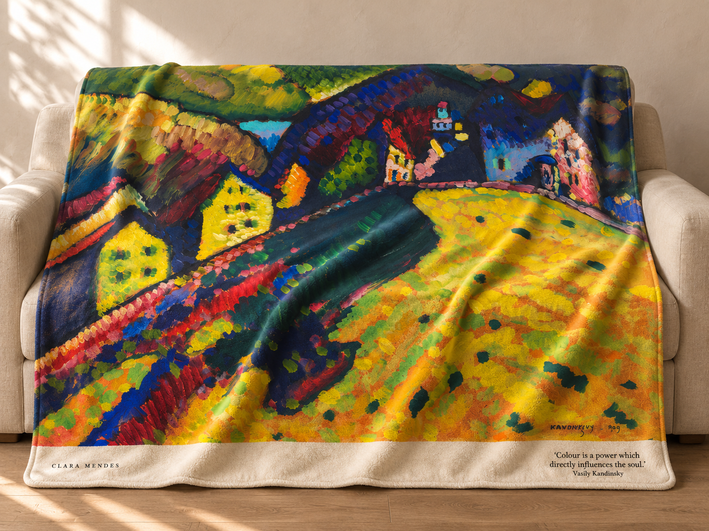

# Kandinsky blanket reference

**Purpose:** the single AI-generated visual reference shown to the owner on 16 November 2026. It illustrates the requested discreet black lettering and small Clara Mendes credit. It is not a supplier photograph, exact reproduction proof, production file or sample-quality result.

**Artwork shown:** Vasily Kandinsky, *Houses at Murnau* (1909), Art Institute of Chicago object 129849. Existing registry key: `aic-129849`; [museum record](https://www.artic.edu/artworks/129849/houses-at-murnau). The preview used the repository's existing framed-print reproduction as its reference. It did not use a newly downloaded full-resolution museum master.

**Quote:** “Colour is a power which directly influences the soul.”

Source: [*Concerning the Spiritual in Art*](https://www.gutenberg.org/cache/epub/5321/pg5321.html), M. T. H. Sadler translation, section V. The complete sentence begins “Generally speaking,”; the concept uses an excerpt. Final quote documentation must record this editorial omission and the translation.

**Generation:** built-in image generation, 16 November 2026. The requested composition was a soft throw on an oat sofa; artwork at original colours; a narrow ivory bottom strip; black serif quote at lower right; smaller artist credit; tiny Clara Mendes at lower left.

**Generation prompt summary:** use the painting inside the supplied print reference, remove the mat/frame; preserve the composition and colours; keep quote block under 22% of blanket width and bottom strip around 6% of blanket height; render one realistic landscape product concept. Exact text: “Colour is a power which / directly influences the soul.”, “Vasily Kandinsky”, “CLARA MENDES”.

**Production boundary:** rebuild from the actual source artwork plus properly typeset text. The AI can change brushwork, proportions, signatures and fabric appearance. Never use the generated signature, text or artwork pixels as source assets. Supplier template, safe area, quality and material remain unverified for this new edition.

The source image and final generated image remain separate. The original generated PNG is copied here without modification so agents can inspect the same reference.

**SHA-256:** `cf631540ad2d8f3962f5f67352f25a21dff8256b13ea077841997506b53db2b7`.
