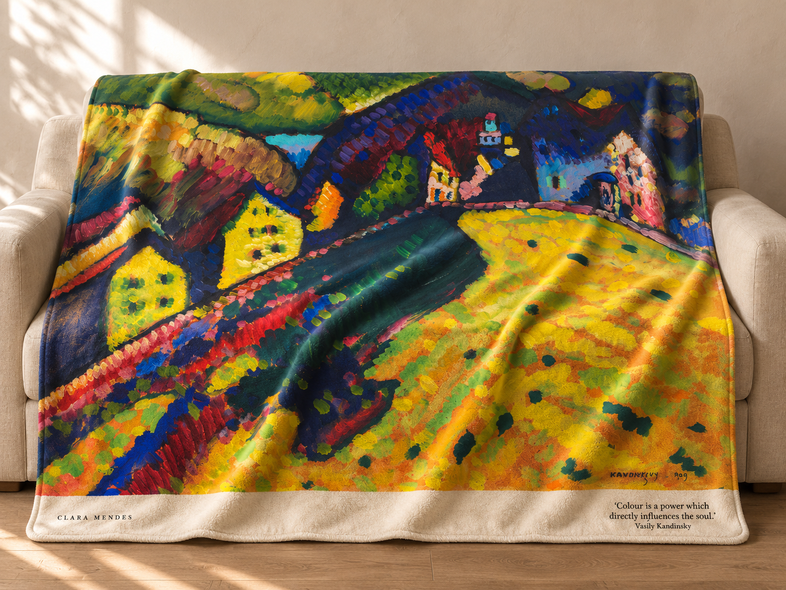

# European Art & Words Blanket Line Implementation Plan

> **For agentic workers:** REQUIRED SUB-SKILL: Use superpowers:subagent-driven-development (recommended) or superpowers:executing-plans to implement this plan task-by-task. Steps use checkbox (`- [ ]`) syntax for tracking. On installations without the namespace, use the corresponding `subagent-driven-development` or `executing-plans` skill.

**Goal:** Prepare a Clara Mendes blanket line covering every current artist direction, with original-colour artwork and discreet black quotations, and establish a verified route to selling it in Europe.

**Architecture:** Extend the existing artist → artwork → product family → variant pipeline with a separate quote-blanket edition. Reuse current Printful blanket support if the exact product meets the European delivery, quality and margin checks. Keep production artwork, quote provenance, supplier mapping and publication approval as separate evidence.

**Tech Stack:** Shopify / Hydrogen, React Router / TypeScript, the existing Node product pipeline, Printful, editable artwork and typeset text layers, supplier-template raster exports.

---

## 1. Start here

- Prepared **16 November 2026**; intended continuation **17 November 2026**, Europe/Bucharest.
- Repository: [Tassos801/Clara-Mendes](https://github.com/Tassos801/Clara-Mendes).
- Shared planning branch: `codex/blanket-quotes-europe-2026-11-16`.
- Tracking and agent coordination: [GitHub issue #205](https://github.com/Tassos801/Clara-Mendes/issues/205), which links the draft PR.
- Verified starting main commit: `9de548678eba6fe79bd86bf9d4ed963bab0a6f04`.
- Read [handoff](../../blanket-line/HANDOFF.md), [status](../../blanket-line/status.md), root [AGENTS.md](../../../AGENTS.md), then this plan.
- This checkpoint contains a plan and an AI visual reference. It contains no new production files, supplier quotes, approved prices, Shopify products, mapping evidence or release approval.
- This is a product-development and launch plan. The detailed software patch must be based on the supplier and provenance decisions below; do not implement guessed supplier capabilities.

## 2. Owner direction

The owner requested all artists currently represented in the shop, artwork with a quote in black letters, a more discreet treatment, one preview, and a Europe-oriented line. They then asked for a GitHub plan usable by other agents tomorrow.

Interpret “blacked designs” in the final request as **the illustrated blanket designs with black lettering**, consistent with the conversation and preview. Do not turn the artwork monochrome or put everything on a black ground.

Working collection name: **Art & Words**. This is a planning name, not an approved final retail name.

### Design rules

1. Preserve source artwork colours, proportions, shapes and identifiable details. Never fade, recolour or paint over the work to make text readable.
2. Make the artwork dominant. Start with a short quote in one or two lines, regular-weight black serif type, occupying about 20% of the blanket width; 22% is the starting upper limit.
3. Place the quote near a lower corner in a quiet light area, or on a narrow plain fabric strip outside the artwork. The reference uses a bottom strip of roughly 6% of the blanket height. Adapt the position to the composition and verified safe area.
4. Put a smaller author credit under the quotation. Use a tiny Clara Mendes credit near the hem. A printed credit does not imply the supplier can add a sewn or woven brand label.
5. Use the same commercially licensed typeface across the line. Record font name, version, licence and file hash. Regular weight must remain legible after printing and washing.
6. Preserve the whole composition where possible. Record any crop or rotation and obtain design approval for a significant crop. Do not generate replacement scenery or rearrange elements of a museum work.
7. English quotes are the initial working edition. Separate legally required local-language product information from the decorative quote; additional quote languages would be separately reviewed editions.
8. One artwork/composition and one quote per artist direction is the initial full range: **14 designs**, not 14 artworks multiplied by every size, fabric and language.
9. Use the illustrated soft printed throw as the starting product format. Woven, knitted, jacquard and wool products would require a separate design/material decision.

### Visual reference



Read [reference provenance](../../blanket-line/reference/README.md). This image is a visual direction, not a print master, supplier mockup or physical quality proof. Do not extract artwork, lettering or the generated signature from it.

The starting quote is the excerpt “Colour is a power which directly influences the soul.” from Kandinsky's *Concerning the Spiritual in Art*, in M. T. H. Sadler's translation. Preserve the source context and record that the opening “Generally speaking,” is omitted. [Text source](https://www.gutenberg.org/cache/epub/5321/pg5321.html).

## 3. Full artist scope

The live [Artists page](https://shopclaramendes.com/artists) was inspected on 16 November. The current main registry and `app/lib/clothingArtists.ts` corroborate this scope. Refresh it before execution; do not silently remove artists if sourcing is difficult.

| Artist direction | Starting artwork/composition to assess | Credit treatment |
| --- | --- | --- |
| Edgar Degas | The Dance Class | Museum reproduction |
| Vincent van Gogh | Irises; compare Wheat Field with Cypresses | Museum reproduction |
| Utagawa Hiroshige | Sudden Shower over Shin-Ōhashi Bridge and Atake | Museum reproduction |
| Katsushika Hokusai | The Great Wave off Kanagawa | Museum reproduction |
| Vasily Kandinsky | Houses at Murnau, the preview reference | Museum reproduction |
| Gustav Klimt | Mäda Primavesi | Museum reproduction |
| Piet Mondrian | Composition with Red, Yellow, and Blue | Museum reproduction |
| Claude Monet | Water Lilies (Agapanthus) | Museum reproduction |
| William Morris | Strawberry Thief; retain the correct design/printing dates | Museum reproduction |
| Pierre-Auguste Renoir | Roses in a Vase | Museum reproduction |
| Johannes Vermeer | The Milkmaid | Museum reproduction |
| Theo van Doesburg | Existing Counter-Diagonal studio composition | Inspired by Theo van Doesburg |
| Kazimir Malevich | Existing Free Abyss studio composition | Inspired by Kazimir Malevich |
| Sophie Taeuber-Arp | Existing Circle Rhythm studio composition | Inspired by Sophie Taeuber-Arp |

These are **candidates**, not final artwork selections. Choose a different existing work by the same artist if its native resolution, proportions or quote placement is materially better, and record the reason.

The last three are Clara Mendes compositions inspired by artists, not reproductions authored by them. Recover their actual editable source packs and quote documentation. Do not use garment photography or web decorative crops as production masters, and do not label studio compositions “Art by” the historical artist.

Clara Mendes Studio's unrelated original-art capsules are outside this 14-artist scope.

## 4. European commercial brief

**Working launch sequence:** qualify EU-27 first, explicitly including Cyprus. Assess the UK, Norway, Iceland, Liechtenstein and Switzerland separately, then other European destinations if supported. “Europe” is not one tax or delivery zone. Keep a row for every intended country; enable only countries with verified product availability, costs, delivery terms and checkout behaviour. Do not change existing US or other-market products to achieve this line's scope.

**Starting supplier candidate:** the existing Printful throw blanket, 50 × 60 in (nominally 127 × 152.4 cm). The current code uses Printful, one-sided polyester, white reverse and a 7500 × 9000 px / 150 dpi supplied file. Historical mapping evidence names Printful variant 10986; re-read the current account before relying on that ID.

Printful's current public product page lists a one-sided polyester throw with a white reverse and several sizes. It does not establish this account's exact EUR cost, European production location or all-country availability. [Product](https://www.printful.com/custom/blankets/personalized/throw), [shipping](https://www.printful.com/shipping).

- Reuse the supplier only if it can render the fine black text clearly and support viable European delivery.
- Distinguish where the blank is manufactured, where it is printed and where it ships from. Do not advertise “made in Europe” merely because European fulfilment is available.
- Verify paid-order routing, order approval/pause settings, supplier billing, failed-payment behaviour, tracking sync, split shipments, replacements and returns supervision.
- If it fails, compare two alternative exact products, including a European production option where available. Choose on delivered economics, print quality and operational effort; do not buy another app or subscription during research.
- Start with one size. A larger size is conditional on independent file-quality, shipping, margin and supplier checks.
- Final retail prices and a sample budget are owner decisions after the cost sheet. No price or delivery promise is approved by this plan.

### Required economics

Create country-level rows for one blanket, two blankets and a mixed basket with an existing Prodigi print. Start detailed checkout checks with CY, GR, DE, FR, NL and IE, then cover every country proposed for launch.

Record exact SKU/variant, destination/postcode basis, quote date, currency, production location, base cost, shipping, supplier tax, recoverable versus non-recoverable tax, import/handling exposure, customer tax-inclusive price, customer shipping income, payment/platform fees, FX costs and a return/replacement reserve. Commit public/sanitised evidence only, never customer addresses, order payloads or credentials.

Use actual applicable tax treatment:
```text
Net receipts = customer product payment + customer shipping payment - output taxes
Contribution before ads = net receipts - production - supplier shipping
                          - non-recoverable supplier/import taxes
                          - payment/platform/FX fees - return/replacement reserve
Contribution after ads = contribution before ads - acquisition cost
```

Do not subtract recoverable VAT twice or treat all supplier VAT as recoverable without confirmation. Show acquisition-cost scenarios of EUR 0, 5, 10 and 15; label them scenarios, not forecasts. Present break-even acquisition cost and EUR 64.99 / 74.99 / 84.99 as price hypotheses only, replacing them if the product evidence suggests otherwise. The owner selects acceptable margin and price from the completed comparison.

### Country readiness

The commerce agent must document the applicable textile-composition and language information, product-safety/traceability information, returns handling and tax/OSS/import treatment for the countries proposed. Do not assume a standard catalogue print-on-demand blanket qualifies for the personalised-goods withdrawal exception. These are release checks to resolve with the supplier/accountant or other qualified help where necessary, not assertions that the current shop already complies.

Primary references:
- [EU textile labelling](https://europa.eu/youreurope/business/product-rules-compliance/textiles-and-footwear/textile-label/index_en.htm)
- [EU online sales obligations](https://europa.eu/youreurope/business/selling-in-eu/selling-goods-services/ecommerce-distance-selling/index_en.htm)
- [EU consumer withdrawal guidance](https://europa.eu/youreurope/citizens/consumers/shopping/returns/index_en.htm)
- [GPSR, including distance-sale information](https://eur-lex.europa.eu/eli/reg/2023/988/oj)

## 5. Repository integration map

Read current source before changing it. The older artist-shop handoff has historical branch names and state; it is background, not an instruction to leave this branch.

| Existing path | Purpose / action |
| --- | --- |
| `data/art-registry.json`, `data/museum-evidence/` | Existing artwork identity, museum sources, rights/master reviews |
| `data/print-catalog.json`, `data/art-product-catalog.json` | Existing artwork/collection and product-family records; preserve live entries |
| `app/lib/artProductCatalog.ts` | Family specification, handles/SKUs, signatures, release checks and provider mapping |
| `scripts/product.mjs`, `scripts/lib/art-product-pipeline.mjs` | Shared prepare, stage, mapping, media and release workflow |
| `scripts/lib/art-product-assets.mjs` | Existing previews, including landscape blanket rotation |
| `app/lib/artistShops.ts`, `app/lib/clothingArtists.ts` | Museum artist browsing and separately labelled inspired clothing directions |
| `app/lib/printfulShipping.ts`, `app/lib/printfulShippingFees.ts`, `app/lib/deliveryReach.ts`, `app/lib/deliveryReach.server.ts` | Provider/destination delivery behaviour |
| `docs/add-products-runbook.md` | Actual CLI commands, external launch directory, provider mapping and readback |
| `scripts/blanketPreview.node-test.mjs`, `scripts/artProductPipeline.node-test.mjs`, `scripts/artistShops.node-test.mjs`, `scripts/deliveryReach.node-test.mjs`, `scripts/printfulShippingFees.node-test.mjs` | Existing meaningful regression checks |

At the verified base, there is no `app/lib/catalogApproval.ts`. Do not invent that module or assume an older metafield migration is installed. The current `familyReleaseIssues` checks artist/rights/master/crop approval, image integrity, current assets, native resolution, Shopify IDs and current provider mappings. Preserve those controls and separate publication from fulfilment evidence.

### Product identity decision

Use a new internal family **`quote-blanket`**, retaining the shopper-facing product type **Blankets**. Reuse blanket physical specifications through shared helpers. Target handles such as `houses-at-murnau-quote-blanket`, with distinct SKU suffixes and new Shopify product/variant IDs. Existing `houses-at-murnau-blanket` and all other live blankets must stay intact.

This family is **proposed**, not implemented. Before catalog mutation, the integration agent must:
- Check type unions, family validation, exact-handle lookups, source signatures, Printful routing, preview rotation, artist grouping and product facts for hardcoded `blanket` checks.
- Include quote text, author/translation/source identity, font hash, layout geometry and renderer version in the production asset signature. A quote or layout change must invalidate old asset and mapping verification.
- Represent the three inspired designs with their true studio authorship and historical-artist inspiration. Do not falsify museum IDs or change `clothingArtists.ts` to classify blankets as garments.
- Document the required registry extension for studio compositions and artist discovery before implementing it.
- Keep every new product unreleased and hidden until its own evidence passes; do not copy release approvals, provider IDs or low-resolution waivers from existing blankets.
- Adapt the current image-integrity check truthfully for deterministic composition. Do not set `provenance.aiFill.block_identical` to true merely to satisfy an old guard.

## 6. Work packages and agent ownership

One lead integrates the shared branch. Parallel agents use separate sub-branches/worktrees based on it and PRs targeting it; no concurrent writers to shared registry or catalogue files. Agree ownership in the tracking issue and update [status](../../blanket-line/status.md) at each handoff.

| Agent role | Owned deliverables | Dependencies |
| --- | --- | --- |
| A — art and quotation research | `docs/blanket-line/art-and-quotes.md`, sanitised source evidence under `docs/blanket-line/evidence/` | Can start immediately |
| B — European supplier and economics | `docs/blanket-line/europe-commerce.md`, `docs/blanket-line/europe-costs.csv`, country/operations evidence | Can start immediately |
| C — textile design | `assets/blanket-line/`, design review sheets and production provenance | Starts with A's cleared source and B's confirmed template |
| D — catalogue and storefront | Integration design, code/data changes and regression tests | Read-only audit immediately; implementation after A/B/C decisions |
| Lead / QA | Shared plan/status, integration, final verification and owner review | Integrates all roles |

### Task 1 — Recover the current catalogue and quotations (Agent A)

**Read:** registry, museum evidence, `clothingArtists.ts`, the current 14 artist pages/collections and their actual source packs.

**Create:** `docs/blanket-line/art-and-quotes.md`; source evidence with stable URLs and retrieval dates.

- [ ] Refresh the 14-row scope against current main and the live shop; record additions or removals for the owner.
- [ ] Select a candidate per artist, recording artwork ID (where applicable), full title, date, source image dimensions/hash and image-specific commercial reuse basis.
- [ ] Find a short authenticated quotation per design in an artist's writing, letters, a museum archive or a documented scholarly source. Record exact wording, author, work/letter/date/page, original language, translator, translation rights and any omitted words.
- [ ] For Kandinsky, verify the supplied excerpt and keep its source context; the preview itself is not quote evidence.
- [ ] Recover the Free Abyss and Circle Rhythm source/translation records from the existing design packs. Reuse their provenance only after checking the exact wording.
- [ ] If an artist has no reliable quotation, mark that row “No authenticated quote found” and propose an original Clara Mendes line clearly credited to the studio. Obtain the owner's choice before artwork production for that row. Do not invent a Vermeer or other artist quotation, silently substitute an internet attribution or drop the artist.
- [ ] Separate artwork credit from quote authorship when they differ. Each row ends with a concrete cleared/needs-decision status and next action.

**Acceptance:** all 14 directions accounted for, each with traceable artwork and quote evidence or a named unresolved decision. No “Art by” credit on the three inspired studio compositions.

### Task 2 — Qualify the European product and economics (Agent B)

**Create:** `docs/blanket-line/europe-commerce.md`, `docs/blanket-line/europe-costs.csv`.

- [ ] Inspect the connected Printful account read-only for the exact current throw variant, print template, file size limits, available print regions, stock/availability, fulfilment locations and EUR billing.
- [ ] Record template dimensions, bleed, seam/safe-area tolerances, minimum text guidance, fabric, reverse, finish, care and supported brand/label options.
- [ ] Quote every proposed country; list EU-27 separately from UK/EEA/Switzerland and any other requested European destination.
- [ ] Record both supplier cost and checkout charge for one/two/mixed baskets. A public “Europe” shipping row is insufficient for Cyprus or every destination.
- [ ] Complete the contribution model and candidate prices above. Distinguish quoted values, estimates and owner decisions in each row.
- [ ] Verify order transmission, billing/approval, production release, tracking, returns, failed payment and exception-handling steps.
- [ ] Complete the country-readiness checks and propose a precise launch-country list plus excluded countries and reasons.
- [ ] Recommend the existing Printful product or produce the two-product fallback comparison. Present a priced sample proposal without placing an order.

**Acceptance:** exact supplier/variant/template evidence, practical operating workflow, country-level costs and an owner-reviewable price/sample decision.

### Task 3 — Prove the design system on contrasting artworks (Agent C)

**Create:** `assets/blanket-line/README.md`, three editable candidate layouts and a contact sheet. Keep large masters in the documented launch directory; commit manageable previews and checksums.

- [ ] Use Kandinsky (dense colour), Mondrian (geometry) and Hokusai (landscape) to prove that the same discreet black typography can work across different compositions.
- [ ] Fit the actual source artwork and independently typeset text in editable layers. Include font and source hashes, quote credit and normalised text/strip coordinates.
- [ ] Make one full-view, one sofa-drape and one close-up quote view per candidate. Label generated scenes as concepts.
- [ ] Confirm the artwork is recognisable, text remains readable without dominating, credits are correct, and no signature or important subject is obscured.
- [ ] Confirm the complete artwork-plus-text layout rotates together when adapting a landscape blanket to the portrait supplier template.
- [ ] Present the three candidates and specific changes from the reference for owner design review. This is a proof of the system; the scope remains all 14 artists.

**Acceptance:** selected typeface and placement system, clear actual-size text test, and editable layouts using real assets rather than extracted AI output.

### Task 4 — Build all 14 production candidates (Agent C with A/B)

**Create:** `assets/blanket-line/designs.json` (design/provenance manifest), review previews and production export records.

Each design record must identify: design ID, museum or studio source kind, artwork/source IDs and hashes, artist versus inspiration credit, quote text/author/source/translation record, font licence/hash, layout coordinates, intended physical orientation, supplier/variant/template version, native artwork PPI, output pixel size/profile/hash, review status and evidence paths. This is a production manifest, not a replacement Shopify catalogue.

- [ ] Expand the approved system to each cleared artist row. Keep unresolved rows visible in status.
- [ ] Use the exact confirmed template. The current 7500 × 9000 / 150 dpi file is a baseline to verify, not proof that every new artwork has 150 native PPI.
- [ ] Calculate native artwork PPI from source pixels divided by printed inches before upsampling. The registry's 2920-pixel-wide Houses at Murnau image would give about 49 native PPI across 60 inches; find a better source or seek a specific quality decision rather than calling an enlarged export high-resolution.
- [ ] Export text from properly typeset/vector layers at final resolution. Keep artwork unchanged, document geometric transforms and verify intact source regions.
- [ ] Check spellings, punctuation, attribution, margins, bleed, orientation, reverse-side description, profile, dimensions, file size and export checksum.
- [ ] Obtain physical sample evidence for fabric, black-letter legibility, colour, seam tolerance and washing, or record a specific owner-approved alternative quality process. An old product's sample waiver does not approve this new line. Sample purchases require the owner's budget authorisation.

**Acceptance:** 14 accounted-for designs; each release candidate has reproducible assets and separate design/quality decisions. No blanket claimed ready because its AI scene looks good.

### Task 5 — Extend and test catalogue support (Agent D)

**Modify only as required:** files in the integration map. **Create:** `docs/blanket-line/integration.md` and focused regression cases in the existing test suites (or a small `scripts/quoteBlankets.node-test.mjs` where the behaviour is distinct).

- [ ] Write an integration decision record covering `quote-blanket` family identity, museum/studio source handling, quote metadata/signatures, artist discovery and country availability.
- [ ] Add regression cases that fail for handle/SKU collisions, quote changes retaining stale mappings, wrong source attribution, wrong landscape text rotation, missing quote evidence and accidental visibility before approval.
- [ ] Extend the shared pipeline; use data for the 14 designs and no per-artist launch scripts or new release-flag lists.
- [ ] Preserve existing blank/no-quote blanket handles, IDs, files, prices, mappings, galleries and publication state.
- [ ] Check museum and inspired products appear in the intended artist and Blankets browsing paths without becoming clothing or falsely appearing to be museum reproductions.
- [ ] Record the exact accepted collection identifiers and commands in `integration.md` before any external writes. Do not run the new family through the CLI until it actually exists and dry runs pass.

Run the applicable focused tests, then the full gate after code changes:
```sh
node --test scripts/blanketPreview.node-test.mjs scripts/artProductPipeline.node-test.mjs scripts/artistShops.node-test.mjs scripts/deliveryReach.node-test.mjs scripts/printfulShippingFees.node-test.mjs
npm test
npm run lint
npm run typecheck
npm run build
```

**Acceptance:** meaningful tests pass and a read-only plan identifies only the new quote editions. The software implementation is not part of the initial documentation checkpoint.

### Task 6 — Stage and verify hidden products (Lead / commerce agent)

**Update:** catalogue IDs and mapping records through the existing pipeline; sanitised evidence under `docs/blanket-line/evidence/`.

- [ ] Before live writes, confirm the resumed session authorises this new line's Draft staging and supplier mapping. The present request authorises planning/GitHub publication, not a product launch.
- [ ] Record an exact target-handle/SKU allowlist and a baseline of existing blanket records.
- [ ] Run shared-pipeline prepare and stage dry runs with the new family and reviewed collection identifiers.
- [ ] Create distinct hidden Shopify Drafts only when authorised, with approved price/specifications and correct museum/inspired copy.
- [ ] Upload the deterministic file, map each exact variant in Printful and read back current file/hash, placement, provider ID and fulfilment location. Ensure the competing Prodigi route is not active for the same variant.
- [ ] Verify Draft status and lack of public visibility after sync; provider inventory changes do not establish publication approval.
- [ ] Apply the reviewed shipping profile/country reach only to the new products. Verify one, two and mixed baskets, destination currency, total price and shipping.
- [ ] Confirm existing blanket IDs/files/mappings/prices remain unchanged and write the before/after evidence.

**Acceptance:** correct hidden Drafts and provider mappings, correct economics/checkout evidence and no existing-product regression. No storefront launch yet.

### Task 7 — Review, release and observe (Lead / owner)

- [ ] Assemble a release table per design and country: artwork/quote rights, design, file quality, physical-quality evidence, exact mapping, price/margin, shipping/returns information, product safety/labels, copy and publication decision.
- [ ] Give the owner final previews, sample findings, margins, country list and remaining exceptions. Resolve exclusions or conditional approvals explicitly.
- [ ] With explicit release authorisation, use the existing release workflow and reviewed PR; publish only the approved design/country scope.
- [ ] Verify artist browsing, Blankets filtering, search, product page, cart, checkout handoff, availability and sitemap. Test at 360/390/430 px and desktop. Check quote close-ups and metric dimensions.
- [ ] Check Merchant Center/product-feed reach so a Europe-only offer is not advertised as orderable elsewhere. Do not rewrite unrelated global market setup.
- [ ] Inspect the first authorised real order from payment to provider acceptance, billing, tracking and delivery. Record redacted operational evidence.
- [ ] Review conversion/add-to-cart, contribution after acquisition cost, delivery, defects, returns and customer comments after the first 10 orders or 30 days, whichever arrives first.

**Rollback:** if a new edition has a wrong file, misattributed quote, mapping failure or unprofitable/unavailable destination, hide only that new edition/country, pause unsubmitted affected jobs where supported, retain evidence and escalate to the owner. Do not deactivate existing no-quote blankets or cancel/alter paid orders without the appropriate authorisation.

## 7. Tomorrow's first session

1. Lead reads handoff/status, fetches this branch and checks current main/PR changes.
2. Claim ownership; assign A and B independently, with D doing a read-only integration audit.
3. C starts the Kandinsky layout only after its source/quote and the supplier template are available.
4. End the session with all 14 rows accounted for, the exact supplier/template, a completed or explicitly blocked country-cost matrix, three layout proofs where dependencies permit, and a documented integration decision.
5. Push coherent checkpoints and record actual evidence, unresolved questions and the next concrete command. Tomorrow is a development session, not a promised launch date.

## 8. Definition of done

- Every one of the 14 artist directions has a verified edition or a named owner-approved deferral.
- Each released edition has correct authorship/quotation provenance, approved layout, adequate file/physical-quality evidence and current supplier mapping.
- Every enabled European destination has a reviewed cost/returns/tax/product-information basis and verified checkout.
- New editions have distinct product identity and existing products remain intact.
- The owner authorises the concrete release scope; the live purchase path and initial fulfilment are verified.
- All shared decisions and evidence are accessible from GitHub; secrets and private customer data remain outside it.
